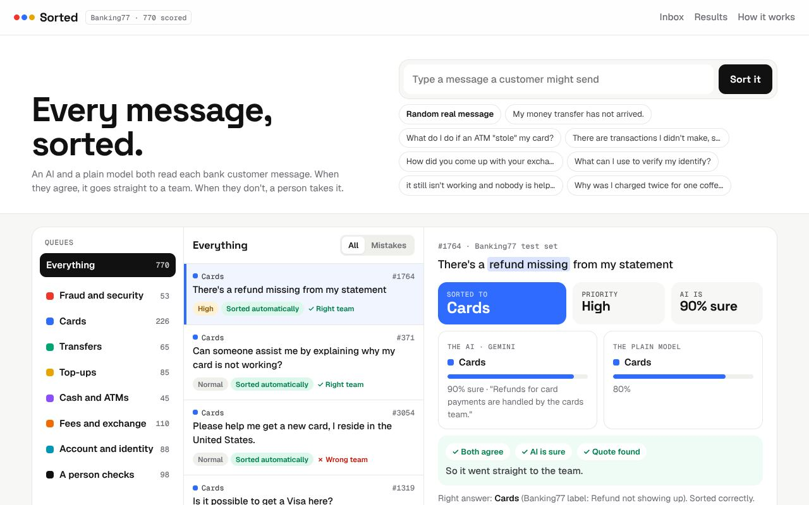

# Sorted

Routes bank support messages to the right team, but only when an AI and a plain model agree. When they don't, a person decides.

[Try it](https://lekanlawal1.github.io/project2-ai-ticket-triage/) · [Try it on your own messages](https://lekanlawal1.github.io/project2-ai-ticket-triage/own.html)



## Why I built it

The first version of this project filed angry complaints as billing questions at 95% confidence, and nothing flagged it. An AI's confidence in itself isn't something you can rely on, so I wanted a second opinion that doesn't come from the same AI.

## How it works

Gemini picks a team and quotes the words that decided it. A small text classifier (TF-IDF and logistic regression), trained on 10,000 real bank messages, picks one too. It runs in your browser and never sees the AI's answer. A message is sent on only if both agree, the AI is at least 80% sure and its quote is really in the message. Otherwise it waits for a person, with the reasons. I set the 80% bar before scoring anything.

The messages come from Banking77, a public set of 13,083 real customer messages labelled by people. I grouped its 77 request types into seven teams a bank would have, before running any model. None of the test data is mine, so anyone can check the scores.

## What I found

On 770 test messages, 87% were sorted automatically and 99% of those went to the right team (6 mistakes out of 672). Trusting the AI's confidence on its own would have sent 64 to the wrong team.

The surprising part: with 10,000 examples to learn from, the plain model was just as safe on its own. The AI earns its place when a team has much less history. On the "your own messages" page, with only 577 past messages to train on, requiring the AI to agree let 6 fewer mistakes through than the plain model alone. Most support desks have hundreds of past messages, not tens of thousands.

## Trying it on your own messages

The second page is a trial for a real support desk. You upload past messages as a CSV, describe your teams in a line each, and it trains the plain model in your browser, sends up to 200 messages to the AI with emails, links and long numbers hidden first, and reports how many would have been routed automatically and how many of those were right. It doesn't connect to a helpdesk. Running it on live messages would need that, plus a paid AI account and a few weeks where it only suggests.

## Run it

```bash
pip install -r pipeline/requirements.txt
python pipeline/baseline.py                          # train the plain model
GEMINI_API_KEY=... node pipeline/run_gemini.mjs      # ask Gemini about the 770 test messages
node pipeline/evaluate.mjs                           # score both
node --test tests/*.test.mjs worker/test/*.test.mjs
cd site && python -m http.server 8800                # http://localhost:8800
```

## More

[docs/details.md](docs/details.md) has the full write-up: the scoring, where the AI goes wrong, the trial page step by step, and what using it for real would take.
